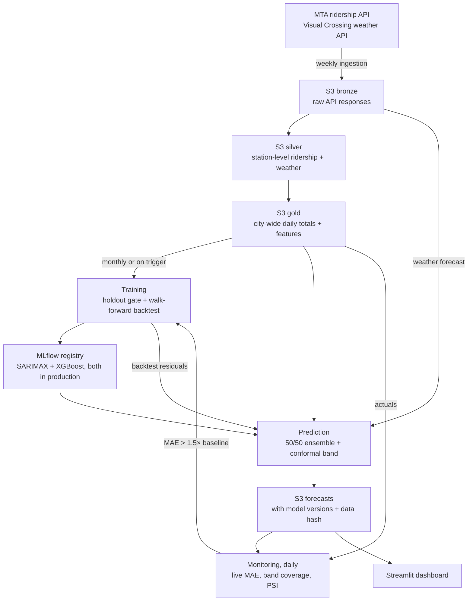

# NYC Transit Demand Forecasting

[](https://github.com/Keerthana-Suresh-Anand/nyc-transit-demand-forecasting/actions/workflows/ci.yml)

**Live dashboard:** https://nyc-transit-forecasting.streamlit.app/

An end-to-end ML system that forecasts daily NYC subway ridership 14 days ahead. It retrains, forecasts and monitors itself on scheduled GitHub Actions, with S3 for storage, MLflow for the model registry and DVC for data versioning.

Weather was the starting hypothesis. It's included as a predictor and tested directly, and the evidence (SHAP, SARIMAX p-values, weak day-level correlations) shows it's a minor one. Recent ridership and the day-of-week pattern carry most of the signal.

## Results

14-day rolling-origin walk-forward backtest (11 weekly origins, 154 forecast points):

| Model | MAE (M riders) | MAPE | MASE |
|-------|---------|------|------|
| Persistence | 0.819 | 31.8% | 2.29 |
| Seasonal-naive (m=7) | 0.357 | 13.5% | 1.00 |
| SARIMAX | 0.260 | 10.3% | 0.73 |
| XGBoost | 0.219 | 8.7% | 0.61 |
| **Ensemble 50/50** | **0.216** | 8.9% | **0.60** |

The ensemble beats seasonal-naive (same weekday last week) by ~40%. Seasonal-naive is the benchmark that matters here; persistence is a weak baseline on a series this weekly-seasonal.

## How it works

The MTA publishes ridership weekly (Wednesdays) with a ~1-week lag. Each week the system:

1. **Ingests** MTA ridership and Visual Crossing weather, then builds the silver and gold layers on S3 and snapshots them with DVC
2. **Forecasts** the next 14 days with a 50/50 SARIMAX + XGBoost ensemble and a 90% conformal prediction band

Monthly (or on a drift trigger), it **retrains** both models and promotes each one only if it beats its current production version. Daily, it **monitors** live forecast error and triggers a retrain if accuracy degrades.



Silver and gold are versioned with DVC. All compute runs on GitHub Actions (pipelines, inside the published Docker image) and Streamlit Community Cloud (dashboard). AWS is storage only.

| Workflow | Trigger | Does |
|----------|---------|------|
| Ingestion | Wednesdays 21:00 UTC | Fetch new data, rebuild silver + gold, DVC snapshot, dispatch prediction |
| Training | First Wednesday of the month, or dispatched by monitoring | Train, gate, register, run walk-forward backtest, dispatch prediction |
| Prediction | Dispatched by ingestion or training | Write the 14-day ensemble forecast to S3 |
| Monitoring | Daily 08:00 UTC | Score past forecasts against actuals, compute PSI, dispatch training on degradation |
| CI & Docker | Push / PR to main | Lint, unit + integration tests; on main, build and push pipeline + dashboard images |

## Models

**SARIMAX:** weekly seasonality with exogenous temperature, precipitation, lagged snowfall and holidays. The order is found by `auto_arima`, cached to S3 and reused for 90 days, so the production model (and its coefficients) stays comparable from one retrain to the next.

**XGBoost:** ridership lags (1, 2, 3, 7, 14 days), 14-day rolling mean, 7-day rolling std, lagged weather and calendar features. Forecasts 14 days recursively, feeding its own predictions back as lags. SHAP values are computed every training run.

**Ensemble:** 50% SARIMAX + 50% XGBoost (`src/utils/config.py`).

**Promotion:** each model is scored on a 30-day holdout, then refit on all data before registration. A new version takes the `production` alias only if its holdout MAE beats the current production version of the same model. Both models stay in production at all times since the ensemble needs both; the "champion" is recorded as metadata only.

## Evaluation

The walk-forward trains once, then rolls a 14-day forecast origin forward weekly, matching the production horizon and re-anchoring cadence. A single long holdout would unfairly penalize XGBoost, whose recursive error compounds over horizons it never serves.

**Why 50/50.** Block-bootstrap 95% CIs on pairwise MAE differences (10,000 resamples of whole 14-day origins):

| Comparison | ΔMAE | 95% CI | Verdict |
|------------|------|--------|---------|
| SARIMAX − XGBoost | +0.041 | [−0.005, +0.094] | tie |
| Ensemble − XGBoost | −0.003 | [−0.025, +0.021] | tie |
| Ensemble − SARIMAX | −0.044 | [−0.075, −0.016] | ensemble better |

SARIMAX and XGBoost are statistically tied, so there's no reliable basis for an unequal weight; the grid-search optimum (0.35 SARIMAX) is within 0.003 MAE of 50/50. The ensemble significantly beats SARIMAX and ties XGBoost, so keeping both models costs nothing and helps against one of them.

**Prediction band.** The 90% band is conformal, calibrated on the ensemble's own walk-forward residuals. Scores are pooled across horizon steps and rescaled per step, so the band widens with lead time. Coverage is marginal across the horizon (not per step) and approximate, since rolled-origin residuals aren't strictly exchangeable. Live coverage is tracked daily.

## Monitoring

- **Retrain trigger:** rolling forecast MAE > 1.5× the walk-forward ensemble MAE (falls back to the 30-day holdout MAE if no backtest exists). A 7-day cooldown stops persistent degradation from dispatching training every day.
- **PSI** on weather features (last 14 days vs the prior 90) is reported on the dashboard but never triggers retraining. Weather drifts with the seasons, so it would fire false alarms every spring and fall.
- **Traceability:** every forecast records the model versions, MLflow run IDs and the gold-data DVC hash that produced it.

## Dashboard

The [live dashboard](https://nyc-transit-forecasting.streamlit.app/) shows the 14-day forecast with its prediction band and the MTA data-lag window, backtest accuracy and significance tests, live forecast-vs-actual, SHAP and SARIMAX coefficients, the weather analysis, and pipeline health.

## Project structure

```
src/
  ingestion/        MTA and weather fetchers; silver merge
  transformation/   gold-layer feature engineering
  training/         SARIMAX and XGBoost trainers
  evaluation/       promotion gate, walk-forward backtest, PSI
  prediction/       ensemble forecast + conformal band
  monitoring/       rolling MAE, drift report, retrain trigger
  dashboard/        Streamlit app
  utils/            config, S3, MLflow registry, lineage
pipelines/          run_* entry points called by GitHub Actions
tests/              unit + integration (pytest)
docker/             pipeline and dashboard images
notebooks/          EDA
```

## Running locally

```bash
git clone https://github.com/Keerthana-Suresh-Anand/nyc-transit-demand-forecasting
cd nyc-transit-demand-forecasting
pip install -e ".[pipeline,dev]"
cp .env.example .env        # AWS, NYC Open Data, Visual Crossing keys

pytest
streamlit run src/dashboard/app.py
```

**Bootstrapping a new S3 bucket:**

```bash
python -m pipelines.run_ingestion     # bronze → silver → gold on S3
python -m pipelines.run_training      # train + register models in local MLflow
aws s3 cp mlflow.db s3://YOUR_BUCKET/mlflow/mlflow.db
aws s3 sync mlruns/ s3://YOUR_BUCKET/mlflow/mlruns/
python -m pipelines.run_prediction    # first forecast → S3
```

After that the scheduled workflows take over. They need these repository secrets: `AWS_ACCESS_KEY`, `AWS_SECRET_KEY`, `AWS_BUCKET_NAME`, `AWS_REGION`, `NY_APP_TOKEN`, `WEATHER_API_KEY`, `DOCKERHUB_USERNAME`, `DOCKERHUB_TOKEN`.

To browse MLflow runs from CI, pull the store from S3 and run `mlflow ui --backend-store-uri sqlite:///mlflow.db`.

> The dashboard installs from `requirements.txt` because Streamlit Community Cloud doesn't support `pyproject.toml` extras. Everything else uses `pyproject.toml`.

## Limitations

- **Short forward reach.** Because of the MTA's ~1–2 week publishing lag, the first part of each 14-day forecast covers days that have already happened but aren't published yet. Only the remainder is truly ahead of today.
- **Low evaluation power.** The backtest is 11 origins over 90 days, one season. CIs are wide; a longer, multi-season window with per-origin refits would tighten them and could justify an unequal ensemble weight.
- **No shock awareness.** The models learn regular patterns and can't anticipate service disruptions, major events or structural breaks.
- **Scope.** Daily, city-wide, one city. Station- or line-level forecasting is a different and much more data-hungry problem.
- **MLflow on SQLite.** The tracking store is a SQLite file synced to S3; a team deployment would use a shared tracking server backed by Postgres.

## Tech stack

Python 3.12 · pandas · statsmodels · pmdarima · XGBoost · SHAP · MLflow · DVC · AWS S3 · Docker · GitHub Actions · Streamlit · Plotly
