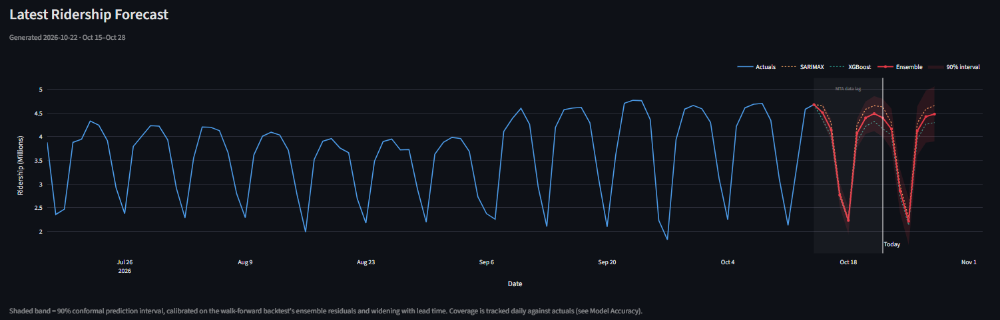
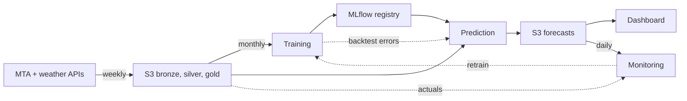

# NYC Transit Demand Forecasting

[](https://github.com/Keerthana-Suresh-Anand/nyc-transit-demand-forecasting/actions/workflows/ci.yml)

**Live dashboard:** https://nyc-transit-forecasting.streamlit.app/


*Snapshot from October 22, 2026. The [live dashboard](https://nyc-transit-forecasting.streamlit.app/) shows the current forecast.*

An end-to-end ML system that forecasts daily NYC subway ridership 14 days ahead. It retrains, forecasts and monitors itself on scheduled GitHub Actions, with S3 for storage, MLflow for the model registry and DVC for data versioning.

Weather was the starting hypothesis. It's included as a predictor and tested directly, and the evidence (SHAP, SARIMAX p-values, weak day-level correlations) shows it's a minor one. Recent ridership and the day-of-week pattern carry most of the signal.

## Results

Walk-forward backtest of Oct 22, 2026: 11 weekly 14-day forecasts, 154 days scored (Jul–Oct 2026). The dashboard shows the latest backtest, so its numbers change with each monthly retrain.

| Model | MAE (M riders/day) | MAPE | MAE vs seasonal-naive |
|-------|---------|------|------|
| Persistence | 0.730 | 27.7% | 3.07× |
| Seasonal-naive (m=7) | 0.237 | 7.2% | 1.00× |
| SARIMAX | 0.187 | 5.4% | 0.79× |
| XGBoost | 0.162 | 4.6% | 0.68× |
| **Ensemble 50/50 (served)** | **0.167** | **4.7%** | **0.70×** |

The ensemble's error is about 30% lower than seasonal-naive, a baseline that predicts each day from the most recent known value for that weekday. XGBoost alone does about as well as the ensemble, and SARIMAX does worse. Over this period every model came in a little low, by about 80,000 riders a day, while ridership was rising.

Persistence (repeat yesterday's value) is there for reference. Weekends carry about half the weekday ridership, so it's an easy baseline to beat.

## How it works

The MTA publishes ridership weekly (Wednesdays) with a ~1-week lag. Each week the system:

1. **Ingests** MTA ridership and Visual Crossing weather, then builds the silver and gold layers on S3 and snapshots them with DVC
2. **Forecasts** the next 14 days with a 50/50 SARIMAX + XGBoost ensemble and a 90% conformal prediction band

Monthly (or on a drift trigger), it **retrains** both models and promotes each one only if it beats its current production version. Daily, it **monitors** live forecast error and triggers a retrain if accuracy degrades.



Bronze holds raw API responses, silver the station-level ridership joined with weather, gold the city-wide daily totals and model features; silver and gold are versioned with DVC. All compute runs on GitHub Actions (pipelines, inside the published Docker image) and Streamlit Community Cloud (dashboard). AWS is storage only.

| Workflow | Trigger | Does |
|----------|---------|------|
| Ingestion | Wednesdays 21:00 UTC | Fetch new data, rebuild silver + gold, DVC snapshot, dispatch prediction |
| Training | Monthly (first week of the month), or dispatched by monitoring | Train, gate, register, run walk-forward backtest, sync MLflow to S3, dispatch prediction |
| Prediction | Dispatched by ingestion or training | Pull the pinned gold version, write the 14-day ensemble forecast to S3 |
| Monitoring | Daily 08:00 UTC | Score past forecasts against actuals (MAE, band coverage), compute PSI, dispatch training on degradation (7-day cooldown) |
| CI & Docker | Push / PR to main | Lint, unit + integration tests; on main, build and push images (pipelines run the `:stable` tag) |

## Models

**SARIMAX:** weekly seasonality, with temperature, precipitation, lagged snowfall and holidays as external inputs. The order is found by `auto_arima`, cached to S3 and reused for 90 days, so the production model's structure (and its coefficients) stays comparable from one retrain to the next.

**XGBoost:** ridership lags (1, 2, 3, 7, 14 days), 14-day rolling mean and 7-day rolling std, same-day and lagged weather, a holiday flag, and calendar features (day of week, month, weekend). Forecasts 14 days recursively, feeding its own predictions back as lags. The backtest and production forecast share one feature path, and a test checks it never reads ridership from the day being forecast or later. SHAP values are computed every training run.

**Ensemble:** 50% SARIMAX + 50% XGBoost (see [Evaluation](#evaluation) for why).

**Promotion:** each model is scored on its most recent 30 days, then refit on all data before registration. A new version replaces the production one only if its holdout MAE is lower. The two MAEs come from different 30-day windows, so this is a sanity gate, not a head-to-head test. That's acceptable because both models always stay in production (the ensemble needs both) and the next monthly retrain corrects a wrong call.

## Evaluation

**Method.** The backtest replays production. Both models are trained on data up to 90 days before the end. Then every 7 days, a 14-day forecast is made using only the data available that day: 11 forecasts, 154 days scored. SARIMAX is updated with new actuals without refitting, and XGBoost's lag features are filled from the latest actuals. A single long holdout would unfairly penalize XGBoost, whose recursive error compounds over horizons it never serves in production. The backtest uses observed weather throughout, while production uses forecast weather for days that haven't happened yet; weather is a minor predictor, so the effect is small.

**Why 50/50.** Block-bootstrap 95% CIs on pairwise MAE differences (10,000 resamples of whole 14-day forecasts, so errors within a forecast stay together). The ensemble is fixed at 50/50 in advance, not tuned on this data:

| Comparison | ΔMAE | 95% CI | Verdict |
|------------|------|--------|---------|
| SARIMAX − XGBoost | +0.025 | [−0.012, +0.060] | tie |
| Ensemble − XGBoost | +0.005 | [−0.014, +0.023] | tie |
| Ensemble − SARIMAX | −0.020 | [−0.038, −0.001] | ensemble better (borderline) |

XGBoost has the better point estimate, but SARIMAX and XGBoost are statistically tied, so there's no reliable basis for an unequal weight; the best weight found by grid search (0.10 SARIMAX) is only 0.006 MAE better than 50/50. The ensemble ties XGBoost and beats SARIMAX, so keeping both models costs no measurable accuracy. With only 11 forecasts that overlap by 7 days, these intervals are approximate and probably a little narrow, so the borderline result is weak evidence; a longer, multi-season backtest is the main next step.

**Prediction band.** The 90% band is conformal: its width comes from the ensemble's own backtest errors. Errors are pooled across all 14 days ahead and rescaled per day, so the band widens with lead time. Coverage holds on average across the 14 days rather than for each day, and it's approximate because errors from consecutive forecasts aren't fully independent. Live coverage is tracked daily.

## Monitoring and traceability

- **Retrain trigger:** each day, forecasts from the models currently in production are scored against actuals as they arrive. Once at least 14 days are scored, training is dispatched if their MAE exceeds 1.5× the backtest ensemble MAE (or the 30-day holdout MAE if no backtest exists). A 7-day cooldown caps retrains at one per week.
- **Band coverage:** the same check reports how often actuals land inside the 90% band.
- **Late-arriving data:** three past days were captured before the MTA finished publishing them (one at 28% of its true value) and stayed wrong, because each date was fetched only once. Each ingestion now re-fetches the last 14 days and replaces them, and gold is checked for drops that no holiday or weather explains. The three days were corrected and the models retrained.
- **Data drift:** PSI on weather features (last 14 days vs the prior 90) is logged in the daily drift report but never triggers retraining. Weather drifts with the seasons, so it would fire false alarms every spring and fall.
- **Pipeline health:** every run logs its status, duration and any error to S3, and the dashboard shows the latest run of each pipeline.
- **Traceability:** every forecast records the model versions, MLflow run IDs, gold-data DVC hash and Docker image digest that produced it.

## Dashboard

The [live dashboard](https://nyc-transit-forecasting.streamlit.app/) is a single page:

- **Headline numbers:** next-7-day ridership total, backtest MAE, and improvement over seasonal-naive, with the serving model versions.
- **Forecast:** the 14-day ensemble with its 90% band, the individual model lines, the MTA data-lag window, and a daily table for the latest week.
- **How it works:** architecture diagram, plus short explainers on the models and evaluation.
- **Model accuracy:** models vs naive baselines, significance tests, live band coverage, error by forecast horizon, live forecast-vs-actual, SHAP and SARIMAX coefficients.
- **Weather:** temperature and precipitation vs ridership.
- **Sidebar:** pipeline health, data coverage, and a link to the source code.

## Project structure

```
src/
  ingestion/          MTA and weather fetchers; silver merge
  transformation/     gold layer: daily aggregation, features, data checks
  training/           SARIMAX and XGBoost trainers
  evaluation/         promotion gate, walk-forward backtest, PSI
  prediction/         ensemble forecast + conformal band
  monitoring/         live MAE and band coverage, drift report, retrain trigger
  dashboard/          Streamlit app
  utils/              config, S3, MLflow registry, lineage
pipelines/            run_* entry points called by GitHub Actions
.github/workflows/    CI and the four scheduled pipelines
tests/                unit + integration (pytest)
docker/               pipeline and dashboard images
```

## Running locally

```bash
git clone https://github.com/Keerthana-Suresh-Anand/nyc-transit-demand-forecasting
cd nyc-transit-demand-forecasting
pip install -e ".[pipeline,dashboard,dev]"
pytest                      # no credentials needed: S3 and APIs are mocked
```

Running the pipelines or the dashboard needs your own S3 bucket and API keys (`cp .env.example .env`).

<details>
<summary>Deploying your own copy</summary>

```bash
python -m pipelines.run_ingestion     # bronze → silver → gold on S3
python -m pipelines.run_training      # train + register models in local MLflow
aws s3 cp mlflow.db s3://YOUR_BUCKET/mlflow/mlflow.db
aws s3 sync mlruns/ s3://YOUR_BUCKET/mlflow/mlruns/
python -m pipelines.run_prediction    # first forecast → S3
streamlit run src/dashboard/app.py
```

After that the scheduled workflows take over. Repository secrets: `AWS_ACCESS_KEY`, `AWS_SECRET_KEY`, `AWS_BUCKET_NAME`, `AWS_REGION`, `NY_APP_TOKEN`, `WEATHER_API_KEY`, `DOCKERHUB_USERNAME`, `DOCKERHUB_TOKEN`.

To browse MLflow runs from CI, pull the store from S3 and run `mlflow ui --backend-store-uri sqlite:///mlflow.db`.

</details>

## Limitations

- **Short forward reach.** The MTA publishes weekly with a ~1-week lag (nearly two weeks by the next release), so the first part of each 14-day forecast covers days that have already happened but aren't published yet. Only the remainder is truly ahead of today.
- **Low evaluation power.** The backtest is 11 forecasts over 90 days, one season. CIs are wide; a longer, multi-season window with per-forecast refits would tighten them and could justify an unequal ensemble weight.
- **No shock awareness.** The models learn regular patterns and can't anticipate service disruptions, major events or structural breaks.
- **Scope.** Daily, city-wide, one city. Station- or line-level forecasting is a different and much more data-hungry problem.
- **Late source corrections.** Each run re-fetches the last 14 days, so partial or revised days heal within a week; a correction to older data would be missed.
- **MLflow on SQLite.** The tracking store is a SQLite file synced to S3; a team deployment would use a shared tracking server backed by Postgres.
- **Static AWS keys in CI.** Workflows use long-lived credentials; OIDC federation (short-lived, per-run) is the planned replacement.

## Tech stack

Python 3.12 · pandas · scikit-learn · statsmodels · pmdarima · XGBoost · SHAP · MLflow · DVC · AWS S3 · Docker · GitHub Actions · pytest · Streamlit · Plotly

## License

[MIT](LICENSE)
